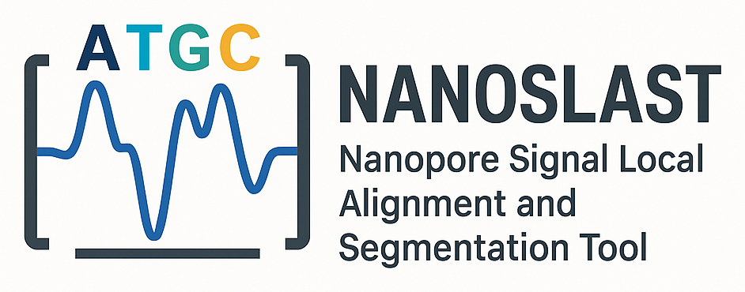

<p align="center">
  
</p>

# NANOSLAST

NANOSLAST is a lightweight Python GUI application that links local sequence similarity search (BLAST) to raw Oxford Nanopore signals (squiggles). It lets you find reads containing a sequence of interest, locate the exact part of the raw signal that corresponds to it, and visualize or export that signal segment.

It works with both raw nanopore data formats, **FAST5** and **POD5**, and with basecalled reads in **SAM** format (Dorado or Guppy) that include move tables.

Typical uses:

- extracting signals of specific motifs or functional elements,
- comparing raw signal characteristics between flowcells or sequencers,
- building signal–sequence datasets for training machine learning models (basecalling, methylation detection, etc.).

## Requirements

- Python 3.10 or newer
- [NCBI BLAST+](https://blast.ncbi.nlm.nih.gov/doc/blast-help/downloadblastdata.html): `makeblastdb` and `blastn` must be on your `PATH`
- Tkinter (bundled with Python on Windows and macOS; on Debian/Ubuntu install `python3-tk`)
- Python packages listed in [requirements.txt](requirements.txt)

> **Note:** NANOSLAST calls BLAST+ through `Bio.Blast.Applications`, which was removed in Biopython 1.86. `requirements.txt` therefore pins `biopython<1.86`.

## Installation

```bash
git clone https://github.com/BioSys-BUT/NANOSLAST.git
cd NANOSLAST

python -m venv venv
source venv/bin/activate        # Windows: venv\Scripts\activate
pip install -r requirements.txt
```

Install BLAST+ separately, for example:

```bash
# Debian/Ubuntu
sudo apt install ncbi-blast+
# conda
conda install -c bioconda blast
```

On Windows, use the installer from NCBI and add its `bin` directory to `PATH`.

## Running

```bash
python main.py
```

## Input data

| Data | Format | Notes |
|---|---|---|
| Basecalled reads | SAM | Unaligned or aligned. Must contain move tables (`mv:B:c` tag) and trimmed samples (`ts:i` tag). With Dorado, use `dorado basecaller ... --emit-moves --emit-sam`. |
| Raw signals | FAST5 or POD5 | Pass a directory; it is searched recursively. Single-read and multi-read FAST5 files and POD5 files can be mixed. |
| Query sequences | text or FASTA | Paste one sequence, or select a FASTA file with one or more sequences. |

In an aligned SAM file, secondary and supplementary alignments are ignored, and reads aligned to the reverse strand are reverse complemented back to the orientation in which they passed through the pore, so that the sequence matches the move table and the raw signal.

## Workflow

The application has three tabs, **Search**, **Export** and **Plot**. Each can be used on its own, or they can be used in sequence.

### 1. Search

Find reads that contain a query sequence.

1. **SAM to FASTA:** select the SAM file and convert it to FASTA.
2. **BLAST database:** select the FASTA file and a directory where the nucleotide BLAST database (named `blastdb`) will be created with `makeblastdb`.
3. **Run BLAST:** select the database directory, paste the query sequence (or tick *Use FASTA file instead* and click *Select query FASTA file*) and run `blastn`. Each sequence in the FASTA file is searched separately.

The result is saved as a tab-separated TSV file with a header and standard BLAST columns: `qseqid` (the query sequence name from the FASTA file, or `Query` for a pasted sequence), `sseqid` (the read ID), `pident`, `length`, `mismatch`, `gapopen`, `qstart`, `qend`, `sstart`, `send`, `evalue`, `bitscore`.

The search uses `evalue = 0.001` and `max_target_seqs = 1000000` (the maximum number of reads reported for each query sequence). Hits with an alignment shorter than the length of their query sequence minus 10 nt are discarded.

### 2. Export

Extract the raw signal segments that correspond to the BLAST hits.

1. Select the directory with the POD5/FAST5 files, the SAM file and the TSV file from the Search tab.
2. Click **CREATE PARQUET FILE** or **CREATE CSV FILE** and choose the output path.

For each read, NANOSLAST takes the best BLAST hit (highest bitscore, across all query sequences) and combines its coordinates (`sstart`, `send`) with the move table, stride and trimmed samples from the SAM file to calculate where the hit starts and ends in the raw signal. Each element of the move table covers `stride` signal samples after the first `ts` trimmed samples, and a `1` marks the start of a new base, so the segment runs from the first sample of the first matched base to the last sample of the last matched base. Signals are in picoamperes.

The two output formats contain different data:

- **CSV** contains the **whole signal of the read** together with the position of the hit in it, one row per read:
  - `read_id`
  - `query_id`: name of the query sequence that was found (`qseqid`)
  - `sequence`: the matched part of the basecalled read
  - `start_idx`, `stop_idx`: first and last matched base in the read (1-based, inclusive, as in BLAST)
  - `signal`: the whole raw signal of the read in pA, values separated by `;`
  - `start_signal`, `stop_signal`: sample range of the hit in `signal` (0-based, `stop_signal` exclusive, so the segment is `signal[start_signal:stop_signal]`)
  - `direction`: `1` if the query matched the read's forward strand, `-1` if it matched the reverse complement
- **Parquet** contains **only the signal segment of the hit**, one row per read:
  - `read_id`
  - `query_id`: name of the query sequence that was found (`qseqid`)
  - `signal`: the part of the raw signal that corresponds to the hit, in pA

Reads that are not in the SAM file, have no move table, or whose signal is not found in the POD5/FAST5 files are skipped. The final message reports how many reads were exported.

### 3. Plot

Visualize a whole read's signal together with its basecalled sequence.

1. Select the SAM file and the directory with POD5/FAST5 files.
2. Enter a read ID and click **PLOT SIGNAL**.

The plot opens in a new window with zoom and pan tools. The signal is plotted in pA against time in ms. Each base is highlighted with a coloured segment: A red, T blue, C yellow, G green.

## Testing

`tests/test_workflow.py` runs the whole workflow (SAM → FASTA, BLAST, export, plotting) on synthetic reads with known signal positions and checks that every exported segment matches the BLAST hit exactly. It needs BLAST+ on `PATH`:

```bash
python tests/test_workflow.py            # runs in a temporary directory
python tests/test_workflow.py test_out   # keeps the test data, exports and plots in test_out/
```

## Changelog

See [CHANGELOG.md](CHANGELOG.md). Version 1.1.0 fixes the conversion of BLAST hit positions to signal positions; signal segments exported with version 1.0.0 are shifted by a few samples.

## Project structure

```
NANOSLAST/
├── main.py                    # starts the application
├── requirements.txt
├── CHANGELOG.md
├── tests/
│   └── test_workflow.py       # end-to-end test on synthetic data
└── nanoslast/
    ├── __init__.py            # version number
    ├── app.py                 # main window with the tabs
    ├── search_part.py         # Search tab GUI
    ├── convert_sam_file.py    # SAM → FASTA conversion
    ├── create_blastdb.py      # BLAST database creation (makeblastdb)
    ├── blasting.py            # BLAST search (blastn) and hit filtering
    ├── export_part.py         # Export tab GUI
    ├── parquet_tool.py        # best hit per read, signal segment calculation, CSV/Parquet export
    ├── plot_part.py           # Plot tab GUI
    ├── plotting.py            # plotting of a read's signal with its bases
    ├── sam_reader.py          # SAM parsing, move table → signal positions
    ├── signal_reader.py       # POD5 and FAST5 signal loading
    ├── background.py          # runs long tasks without freezing the GUI
    └── assets/
        └── nanoslast_logo.png
```

## Citation

If you use NANOSLAST in your work, please cite:

> M. Jakubickova, M. Zbudilova, M. Suriak, H. Vitkova, "NANOSLAST: Nanopore Signal Local Alignment and Segmentation Tool," in *Proceedings of the 11th World Congress on Electrical Engineering and Computer Systems and Sciences (EECSS'25)*, Paris, France, Aug. 2025, Paper No. ICBES 151. doi: [10.11159/icbes25.151](https://doi.org/10.11159/icbes25.151)

## Acknowledgements

This work was supported by GA23-05845S and NW24-09-00126.

Department of Biomedical Engineering, Brno University of Technology.
